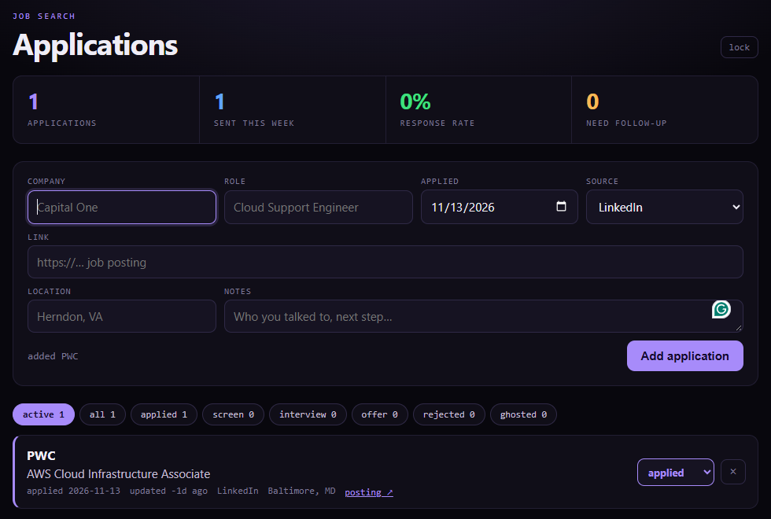
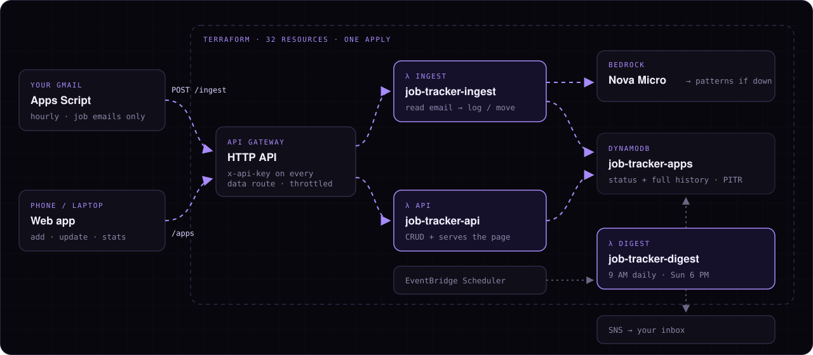
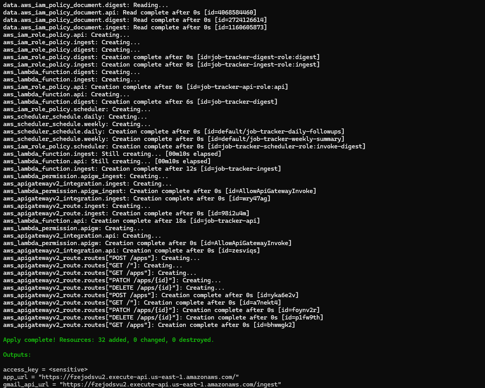
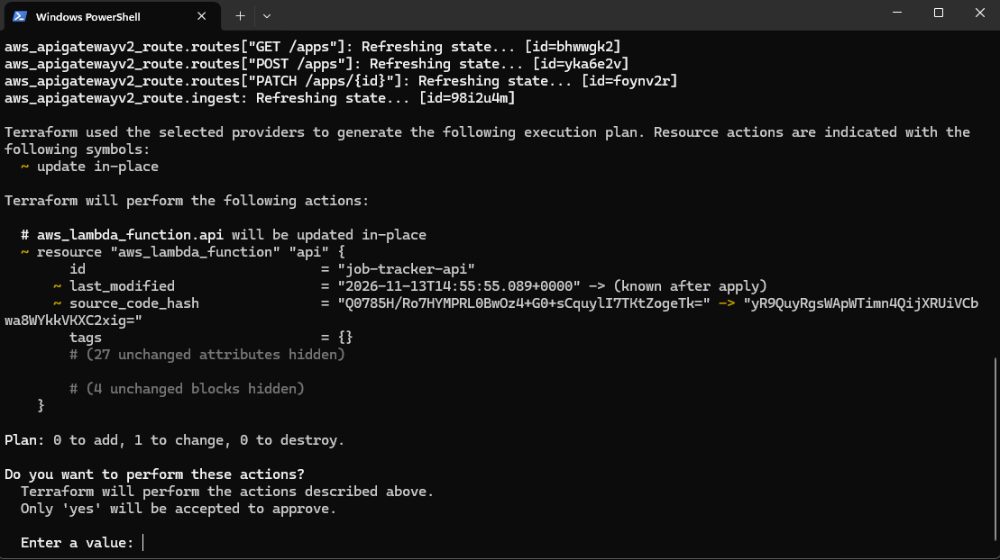
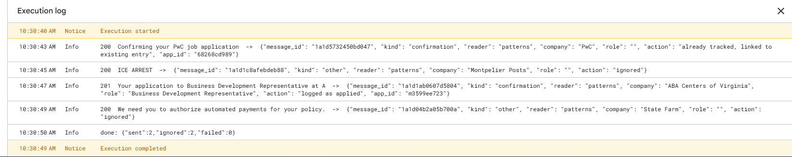
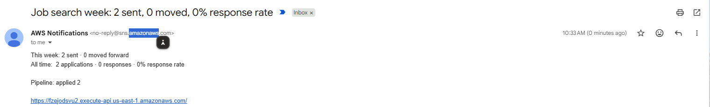

<p align="center">
  
</p>

<p align="center">
  
  
  
  
  
</p>

<p align="center">
  <a href="#-what-it-does">What it does</a> ·
  <a href="#-why-terraform">Why Terraform</a> ·
  <a href="#-how-email-becomes-a-row">Email → row</a> ·
  <a href="#-design-decisions">Design decisions</a> ·
  <a href="#-things-that-broke">What broke</a> ·
  <a href="#-run-it-yourself">Run it</a>
</p>

---

I built this to run my own job search. Applying is the easy part — keeping
track of fifty applications, noticing which ones went quiet, and knowing
whether any of it is working is where things slip.

So the tracker mostly runs itself. When an application confirmation lands in
Gmail, it's logged within the hour. When a rejection or a *"let's schedule a
call"* comes in, the status moves on its own. Every morning it emails a nudge
about anything that's gone quiet; every Sunday it emails the week's numbers.

This is my fourth AWS project, and the first one built entirely as code. The
other three were clicked together in the console, and every one of their
READMEs ends with *"define it in code."* This is that.

<br>

## ◆ What it does

| | |
|---|---|
| **Web app** | Add an application in ten seconds from a phone. Change status from a dropdown — applied → screen → interview → offer, or rejected / ghosted. Stats across the top. |
| **Gmail auto-logging** | A small script in my own Google account checks hourly for application emails and sends them to the tracker. |
| **Reads the email** | Confirmation → new application. Rejection → that application moves to **rejected**. *"Schedule a call"* → **screen**. Everything else is ignored. |
| **Daily nudge, 9 AM** | Anything sitting at *applied* for 7+ days, with the posting link. Each one at most once a week. |
| **Weekly summary, Sunday 6 PM** | Sent this week, moved forward, response rate, pipeline by status. |



<br>

## ◆ How it's built

<p align="center">
  
</p>

| Piece | What it is |
|---|---|
| `job-tracker-api` | Lambda — serves the web page and the CRUD routes |
| `job-tracker-ingest` | Lambda — turns one email into a tracker update |
| `job-tracker-digest` | Lambda — daily follow-ups and the weekly summary |
| `job-tracker-apps` | DynamoDB, on-demand, point-in-time recovery on |
| HTTP API | API Gateway — every data route requires an `x-api-key`, throttled to 10 req/s |
| Two schedules | EventBridge Scheduler in `America/New_York` |
| `job-tracker-digest` topic | SNS → email |
| `gmail/Code.gs` | Google Apps Script, runs hourly in my Gmail — not in AWS |

<br>

## ◆ Why Terraform

**One command builds all 32 resources** — three functions, three roles with
their own policies, three log groups, a table, an API with six routes, two
schedules, a topic, and the key that protects it:



**Shipping a change touches only what changed.** When I fixed a display bug in
the web page, the plan was a single line — Terraform compared the code's hash
and updated one Lambda, leaving the other 31 resources alone:



Compare that with the console projects, where the same kind of change meant
pasting code into an editor and remembering to press Deploy — which is exactly
how [Project 03](https://github.com/ArchitectKeita/aws-fraud-alerts) ended up
running the wrong code for a while.

Things the code now guarantees that I used to get wrong by hand:

- **Every log group has a retention period** and is created by Terraform, so `destroy` removes it too.
- **Every resource is tagged** `ManagedBy = terraform`, so nothing is ever a mystery in the console.
- **My email address never enters the repo.** It's a variable in `terraform.tfvars`, which git ignores.
- **The API key is generated, not typed** — `random_password`, marked sensitive, read with `terraform output`.

<br>

## ◆ How email becomes a row

The Gmail script searches broadly on purpose — rejections almost always say
*"unfortunately"* and recruiters say *"next steps"* — and lets the tracker
decide what each email actually is.



From that real run:

| Email | Read as | Result |
|---|---|---|
| *Confirming your PwC job application* | confirmation · **PwC** | Already tracked by hand → **linked, not duplicated** |
| *Your application to Business Development Representative at ABA Centers of Virginia* | confirmation | **Logged** with company and role |
| *ICE ARREST* (a news alert) | other | Ignored |
| *We need you to authorize automated payments for your policy* | other | Ignored |

Each email gets an ID derived from Gmail's message ID, so sending the same email
twice is refused at the database — and the script only labels a thread after
every message in it went through, so a failure is retried next hour.

<br>

## ◆ Design decisions

**Two readers, one answer.** A small model on Bedrock (Nova Micro) reads each
email. If the model fails *for any reason* — throttled, slow, not enabled —
pattern-matching takes over. An email is never dropped because a model call
failed. (That turned out to matter on day one; see below.)

**The email reader is its own function.** `job-tracker-ingest` is the only
function whose role can call Bedrock. If the web app's key leaked, it still
couldn't run up model usage.

**History, not just status.** Every status change is appended to a `history`
list. The weekly response rate counts applications that *ever* reached
screen / interview / offer / rejected — so an application that went
interview → rejected still counts as a response.

**Reminders that don't nag.** The daily job marks each application it nudged
about with `last_reminded`, and won't mention it again for a week.

**Fail loud.** A missing `TOPIC_ARN` or `API_KEY` prints `CONFIG ERROR` on
every cold start, and every digest result says whether its email was `sent` or
`NOT SENT`. That rule came straight out of a bug in Project 03, where missing
config made the code skip an alert *silently*.

| Function | Can do — and nothing else |
|---|---|
| `api` | scan / put / update / delete on the one table, write its own logs |
| `ingest` | scan / put / update on the table, invoke **one** Bedrock model, write its own logs |
| `digest` | scan / update on the table, publish to **one** SNS topic, write its own logs |
| scheduler | invoke the digest function |

<br>

## ◆ Things that broke

### 1. The AI had no allowance on a new account

The first sync logged every email with `"reader": "patterns"` — and took about
ten seconds each. The model's error, pulled straight from CloudWatch with
`aws logs tail`:

```
ThrottlingException: Too many tokens per day, please wait before trying again.
```

Four short emails don't use up a daily limit. New AWS accounts start with
**almost no Bedrock quota** — the same new-account caution that, separately,
kept CloudShell locked on this account. The fix was three changes:

- **Fail fast.** One attempt with short timeouts instead of four retries — ~2 s per email instead of ~10.
- **Use the cross-region inference profile** (`us.amazon.nova-micro-v1:0`), which draws on a separate allowance.
- **Make the fallback carry the load.** It now handles *"Confirming your PwC job application"* and *"Your application to [role] at [company]"*, both of which it missed the first time.

The design decision paid for itself here: with the model completely
unavailable, every email in the real run was still handled correctly.

### 2. The wrong key, from the wrong folder

The first sync got `401` on every email. The key in the Gmail script was empty
— it had been copied with `terraform output` run from `C:\WINDOWS\system32`,
where Terraform has no state, so it returned nothing. The fix was running it
from the project folder. **Terraform state is per-directory** — a lesson worth
one failed sync.

### 3. A confirmation duplicated an application I'd already logged

I'd added PwC by hand, then the PwC confirmation email created a second copy.
Confirmations now check for an existing application at the same company still
at *applied*, and link the email to it instead.

### 4. "Updated −1 days ago"

A brand-new entry read *updated −1d ago*: the server stamped the time, and the
laptop's clock was a few seconds behind AWS's. The day count is clamped at
zero. It was also the change that proved the update path — one line in the
plan, six seconds to ship.

<br>

## ◆ The weekly summary

Triggered by hand to test it, instead of waiting for Sunday:

```powershell
aws lambda invoke --function-name job-tracker-digest --payload fileb://weekly.json out.json
```



<br>

## ◆ What I'd change in production

- **Real authentication.** One shared key is right for a personal tool; anything multi-user wants Cognito.
- **Query, don't scan.** A scan is the right tool for a few hundred rows. At scale, a `status` + `updated_at` index.
- **Remote state.** Terraform state lives on my laptop. A team needs an S3 backend with locking.
- **CI for the plan.** Run `terraform plan` on every pull request so changes are reviewed as diffs.
- **Request the Bedrock quota increase** — or keep the fallback, which turned out to be good enough.

<br>

## ◆ Run it yourself

Needs Terraform and the AWS CLI configured (`aws configure`).

```powershell
Copy-Item terraform.tfvars.example terraform.tfvars   # put your email in it
terraform init
terraform plan        # Plan: 32 to add
terraform apply
terraform output -raw access_key
```

Then confirm the SNS email, open `app_url`, and paste the key once.

**Gmail auto-logging:** create a project at script.google.com, paste
`gmail/Code.gs`, add script properties `API_URL` (the `gmail_api_url` output)
and `API_KEY`, run `syncApplications` once to grant access, then run
`installTrigger`.

**Tear it all down:** `terraform destroy`.

```
*.tf                 the infrastructure
src/api/             web app + CRUD Lambda
src/ingest/          email → tracker Lambda
src/digest/          daily + weekly email Lambda
gmail/Code.gs        Apps Script for Gmail
assets/              diagrams
screenshots/         evidence from the real deploy
```

<br>

## ◆ Cost

| Resource | Cost at personal-use volume |
|---|---|
| Lambda, API Gateway, Scheduler, SNS | Free tier |
| DynamoDB on-demand + PITR | Cents per month |
| Bedrock Nova Micro | A fraction of a cent per email — or $0 when the fallback reads it |
| **Total** | **≈ $0** — nothing billed by the hour |

<br>

<p align="center">
  <sub>Part of <a href="https://github.com/ArchitectKeita">ArchitectKeita</a>'s AWS portfolio ·
  <a href="https://github.com/ArchitectKeita/aws-ha-web-tier">01 web tier</a> ·
  <a href="https://github.com/ArchitectKeita/aws-snapshot-cleanup">02 snapshot cleanup</a> ·
  <a href="https://github.com/ArchitectKeita/aws-fraud-alerts">03 fraud alerts</a></sub>
</p>
